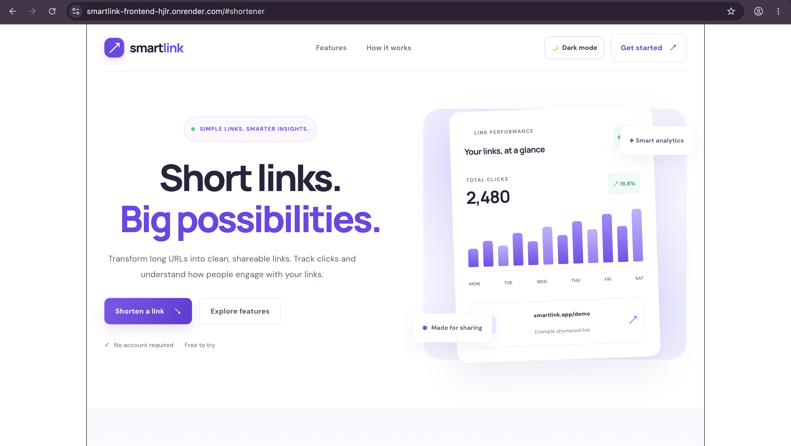
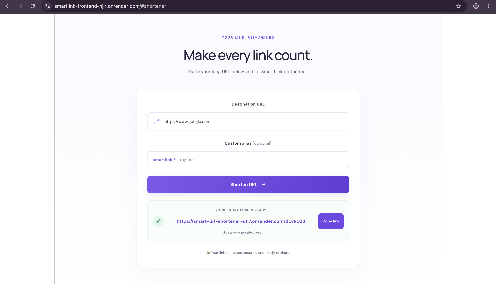
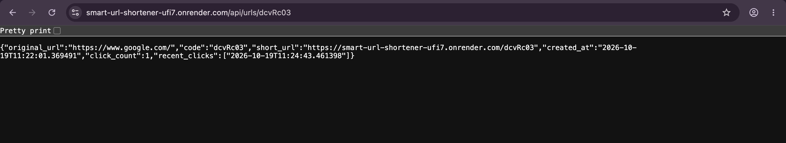

# SmartLink — URL Shortener with Click Analytics

SmartLink is a web application that converts long URLs into short,
shareable links. It also tracks link clicks and provides URL analytics
through a FastAPI backend.

## Live Demo

🌐 Frontend: https://smartlink-frontend-hjlr.onrender.com

⚙️ Backend API: https://smart-url-shortener-ufi7.onrender.com

📖 API Documentation: https://smart-url-shortener-ufi7.onrender.com/docs
## Screenshots

### Homepage


### Shortened URL


### Analytics


## Features

- Shorten long URLs into shareable links
- Redirect users to the original destination
- Track the number of clicks on shortened URLs
- Copy shortened links with one click
- Validate URL input
- Support optional custom aliases
- Responsive interface with light and dark modes

## Tech Stack

### Frontend
- React
- Vite
- JavaScript
- CSS

### Backend
- Python
- FastAPI
- SQLAlchemy
- SQLite

## Architecture

1. The user enters a destination URL in the React frontend.
2. The frontend sends a request to the FastAPI backend.
3. The backend validates and stores the URL in SQLite.
4. The backend generates a unique short code.
5. When someone opens the short link, the backend redirects them
   to the original destination.
6. Each redirect increments the click count.

## API Endpoints

| Method | Endpoint | Description |
|---|---|---|
| GET | `/` | API root |
| GET | `/health` | Health check |
| POST | `/api/urls` | Create a shortened URL |
| GET | `/{code}` | Redirect to the original URL |
| GET | `/api/urls/{code}` | Retrieve URL analytics |

## Run Locally

### Prerequisites
- Python
- Node.js and npm
- Git

### 1. Clone the frontend

```bash
git clone https://github.com/binushaas/smartlink-frontend.git
cd smartlink-frontend
```

### 2. Install dependencies

```bash
npm install
```

### 3. Start the development server

```bash
npm run dev
```

Open the local URL shown in your terminal, usually `http://localhost:5173`.

**Note:** The frontend currently uses the deployed backend API. To run both locally, configure the frontend to use your local backend URL.

## Future Improvements

- Persistent database storage
- More detailed analytics dashboard
- QR code generation
- Improved URL validation and error handling
- Automated testing and continuous integration

## Author

Binusha A. S.

Built with React and FastAPI.
